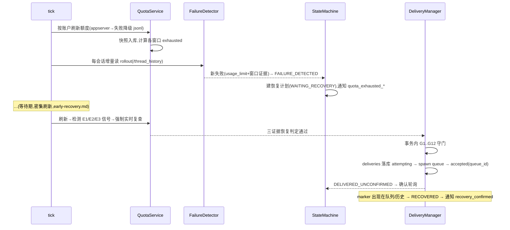

# 系统架构设计(architecture.md)

| 项 | 值 |
| --- | --- |
| 状态 | v1.2(Phase 2 实现同步,D2 经安全复审修订;Phase 3 落地 §2 中 codexif/quota 两包) |
| 覆盖需求 | 全部 FR/NFR 的结构映射 |
| 关联 | 全部专项设计文档 |

---

## 1. 总览

单进程 Python 守护进程 + CLI,六个职责层,外部交互全部收敛到**端口(Ports,可注入接口)**之后——这是"依赖可注入、接口可模拟"(任务书执行规则 13)与 L1 全离线测试(任务书 §六)的结构保证。

```mermaid
flowchart TB
    subgraph 入口层
        CLI[cli/<br>click 命令]
        RUN[run / tick / check]
    end
    subgraph 领域层
        SCH[Scheduler<br>tick 循环与节奏]
        SM[RecoveryStateMachine<br>状态机]
        DET[FailureDetector<br>失败检测]
        QS[QuotaService<br>额度视图与判定]
        PLAN[RecoveryPlanner<br>恢复计划]
        DEL[DeliveryManager<br>守门+投递+确认]
        CONF[ConfirmationWatcher]
        NOT[Notifier / EventBus]
    end
    subgraph 端口层 Ports(全部协议/接口抽象)
        P1[\"CodexCliPort\nqueue 子进程\"]
        P2[\"AppServerPort\n只读 JSON-RPC\"]
        P3[\"RolloutReader\nJSONL 增量解析\"]
        P4[\"CodexSqlitePort\nthread_history/queue 只读\"]
        P5[\"Store(SQLite)\"]
        P6[\"Clock / TimeSource\"]
        P7[\"NotifySink(console/smtp)\"]
        P8[\"CommandRunner(白名单)\"]
    end
    subgraph 外部
        CODEX[codex CLI 二进制]
        AS[codex app-server]
        FILES[~/.codex(sessions/…)]
        SYSDB[(我们的 state.db)]
        MAIL[SMTP]
    end
    CLI-->领域层; RUN-->SCH
    SCH-->QS; SCH-->DET; SCH-->SM; SCH-->PLAN; SCH-->DEL; DEL-->CONF; 领域层-->NOT
    SM & DEL & QS & NOT --> P5
    DEL-->P1-->CODEX; QS-->P2-->AS
    DET-->P3-->FILES; DET & CONF-->P4-->FILES
    领域层-->P6; NOT-->P7-->MAIL; P1 & P8 -.统一白名单校验.- CODEX
```

分层规则:领域层不 import 任何具体 IO(sqlite3/subprocess/socket 只出现在端口实现模块);CLI 层只做参数与输出格式化。

## 2. 模块布局(src/codex_autopilot/)

```
codex_autopilot/
├── cli/                  # click 子命令(add/remove/list/status/quota/history/check/tick/run/pause/resume/doctor)
├── config/               # 配置加载(TOML+env+CLI 合并)、默认值、校验
├── store/                # Store 端口实现:连接、迁移、DAO、启动清扫、备份
│   └── migrations/       # 0001_init.sql …
├── codexif/              # Codex 集成端口实现(codex interface)
│   ├── command_runner.py #   白名单子进程执行(§5)
│   ├── queue_client.py   #   codex queue 投递 + 回执解析
│   ├── appserver.py      #   app-server NDJSON 只读客户端(方法白名单)
│   ├── rollout.py        #   JSONL 增量解析器(撕裂行容忍、事件模型)
│   ├── codexdb.py        #   thread_history/queue SQLite 只读适配(存在则用)
│   └── discovery.py      #   会话文件发现(sessions/**、分裂链、archived)
├── quota/                # 快照解析(双命名兼容)、窗口模型、耗尽/恢复判定
├── recovery/             # 状态机、失败检测、恢复计划、守门、投递管理、确认
├── scheduling/           # tick 循环、节奏控制(密集/常规刷新)、单实例锁
├── notify/               # EventBus、sink(console/smtp)、去重
├── doctor/               # L0/L2 检查实现
└── util/                 # Clock、uuid 校验、路径规范化、审计写入
```

## 3. 数据流:一次完整的恢复周期



## 4. 并发与进程模型(设计决策 D3)

- **单线程 tick 循环**:顺序 = 账户额度刷新 → 每会话检测 → 状态机推进 → 守门 → (至多一次)投递 → 确认轮询 → 通知 → 低频维护(备份/清理)。
- 为什么不是 asyncio/多线程:状态机的正确性来自"评估与落库原子、全局至多一个投递在途";单线程把这两条变成结构属性而非协议负担。性能上 50 会话毫无压力(NFR-07)。
- 唯一的辅助线程:通知发送(SMTP 网络IO,见 notifications.md §1)与 App Server 子进程的读取泵(每账户一个 reader 线程喂队列,主循环消费)——两者都不触碰状态机。
- 子进程:`codex queue`(至多串行)、`codex app-server --stdio`(每账户常驻)。
- systemd 部署形态:`run` 常驻服务(默认)或 `tick` timer 模式(可选),见 deployment.md。

## 5. 安全边界(红线的技术落点)

1. **CommandRunner**(queue-safety.md §9):唯一子进程出口;argv 结构白名单;queue 是唯一变更类命令。
2. **AppServerClient 方法白名单**(queue-safety.md §7):具名方法,无通用 call() 逃生门;黑名单测试锁定(FR-07-A2)。
3. **Store 审计**:一切决策(迁移、守门结果、投递、回执)留痕 append-only。
4. **配置不可扩大权限**(FR-07-A5):配置只提供值(路径、间隔、模板),不提供命令/方法名。
5. **只读纪律**:Codex 侧 SQLite 永远 `mode=ro`;JSONL 永不写;不读 `auth.json`(NFR-09)。

## 6. 错误处理哲学

- 分类:配置错误(启动即拒)、环境错误(codex 缺失/网络断,退避+审计,保持状态)、数据错误(解析失败,跳过+审计,该源降级)、**不确定性(一律 fail-closed → NEEDS_HUMAN)**。
- 守护进程绝不因单会话/单源错误退出;退避有上限;连续 N 次整体失败 → 通知 needs_human 级别事件。
- 任何"看起来能继续但无法证实"的分支,代码评审清单要求显式写明 fail-closed 依据。

## 7. 关键技术决策总表(跨文档汇总)

| # | 决策 | 详细理由所在 |
| --- | --- | --- |
| D1 | Python 3.11+;运行时依赖仅 click | 本表 §8 |
| D2 | SQLite WAL、`synchronous=FULL`、无 ORM、手写迁移(Phase 2 复审:FULL 保证投递幂等,见 persistence.md §2.1) | persistence.md §1/§2/§2.1 |
| D3 | 单线程 tick 循环(非 asyncio/多线程) | 本文档 §4 |
| D4 | 会话注册存 SQLite,全局配置存 TOML | session-management.md §8 D-SES-2 |
| D5 | 账户=CODEX_HOME;额度挂账户、按账户缓存合并查询 | session-management.md §1、quota-monitoring.md §4 |
| D6 | 恢复判定三证据;绝不按固定时长推算恢复 | quota-monitoring.md §5.2 |
| D7 | 唯一变更命令 `codex queue --thread <uuid> --message=<text>`;argv 白名单 | queue-safety.md §1/§9 |
| D8 | 投递前落库 attempting;崩溃后 attempting→unknown→needs_human | persistence.md §7、queue-safety.md §5 |
| D9 | fail-closed:不确定即停 | 全文档(architecture §6) |
| D10 | 通知事件总线+sink;dedup 落库 | notifications.md |
| D11 | XDG 目录;零硬编码 | cli-design.md §5、deployment.md §2 |
| D12 | L1–L4 验收分级;模拟测试为主 | requirements.md §7、testing.md |
| D13 | 消息尾 marker 确认机制 | queue-safety.md §3/§6 |
| D14 | tmux 仅运维信息,不参与决策、不 spawn 进程 | session-management.md §5 |
| D15 | 检测层数据源自适应(thread_history 库优先,JSONL 恒备) | recovery-state-machine.md §4.1 |
| D16 | spawn 后一切不确定为终态 unknown,不重试;仅 spawn 失败可退避重试 | queue-safety.md §4 |

## 8. 技术选型记录(被否决项)

| 选择 | 被否决 | 理由 |
| --- | --- | --- |
| Python 3.11+(tomllib 内置) | 3.10(需 tomli)、Rust/Go(重写参考项目生态成本高、目标用户群 Python 运维友好) | 依赖面最小化 |
| click | argparse(子命令冗长)、typer/pydantic(依赖重)、rich(非必要) | 单依赖、成熟 |
| SQLite | PostgreSQL/Redis/JSON 文件 | 免运维、单文件、事务完整 |
| 守护进程常驻(systemd service)为主 | 纯 timer 触发(提前恢复密集刷新需要常驻;timer 模式保留为可选) | early-recovery.md §3 |
| 结构化日志(stdlib logging + JSON formatter) | 引入 structlog(依赖) | 够用 |
| 常驻 app-server 子进程 | 每次 spawn(参考项目做法,慢;注释:其 Windows 下有受管 daemon 交互问题,Linux L3 再验证) | quota-monitoring.md §4;风险 R-04 |

## 9. 风险与开放问题

见 [phase0-research.md](phase0-research.md) §5 风险登记册(R-01…):协议/回执格式随版本漂移、受管 daemon 与 queue 的 `--remote` 交互、`thread_history` 库的平台差异(本机 0.162.1 无、0.164 桌面版有)、`turn_attribution.turn_trigger` 取值集未核实等。所有"未验证"条目在 L2/L3 验收中闭环,文档中一律显式标注,不猜测为已支持(任务书执行规则 16)。
