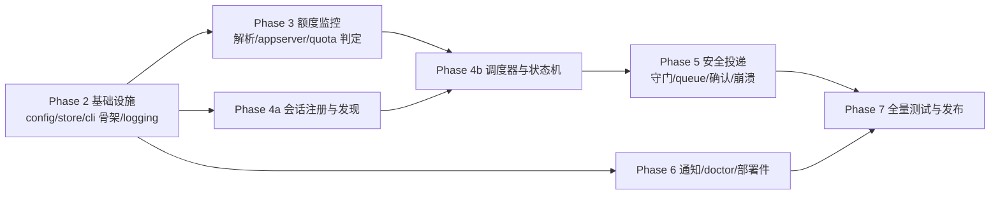

# 开发计划(development-plan.md)

| 项 | 值 |
| --- | --- |
| 状态 | Phase 3 已完成(P3-T1~T4,2026-10-27;见 §2.2 实施记录) |
| 覆盖需求 | 任务书 §七(阶段划分)、§九(本轮后各模块) |
| 关联 | 全部设计文档;测试锚点见 [testing.md](testing.md) |

---

## 1. 阶段总览与依赖

各 Phase 结束必须:全部既有测试绿 + 文档同步(NFR-10)+ 提交带证据说明(L1)。

## 2. 任务分解(编号规则:PHn-Tk;依赖列出直接前置)

### Phase 2 — 核心基础设施(✅ 已完成 2026-10-27)

| ID | 任务 | 产出 | 依赖 | 完成标准(DoD) | 状态 |
| --- | --- | --- | --- | --- | --- |
| P2-T1 | 配置系统 | `config/`(TOML+env+CLI 合并、默认值、校验、示例) | — | 单测覆盖合并优先级与非法值拒绝;examples/config.toml 与代码一致(T-CLI-01) | ✅ |
| P2-T2 | Store 与迁移框架 | `store/`(连接钩子、0001 迁移、DAO 基类、审计写入) | — | T-STORE 基础:迁移幂等、WAL/IMMEDIATE 行为、审计仅 INSERT(T-STORE-03) | ✅(PRAGMA 复审:见下) |
| P2-T3 | 日志与 Clock | `util/`(logging JSON 格式、TimeSource) | — | 假时钟单测 | ✅ |
| P2-T4 | CLI 骨架 | add/remove/list(注册部分) | P2-T1,T2 | T-CLI-ADD-*:UUID/路径/唯一名校验;--json 输出 schema 固化 | ✅ |
| P2-T5 | 单实例锁 | flock 封装 | P2-T2 | T-SCHED-02(S-17) | ✅ |

#### 2.1 Phase 2 实施记录(2026-10-27)

- **交付物**:`src/codex_autopilot/{config,store,util,scheduling,cli}/` + `store/migrations/0001_init.sql`(Schema v1 全量)+ `tests/fakes/clock.py`(Fake 体系起点)+ `.github/workflows/ci.yml`(Python 3.11/3.12/3.13 矩阵 + lint + wheel 冒烟)。
- **架构调整(安全复审)**:`synchronous=NORMAL → FULL`。NORMAL 下 `attempting` 登记可能在 spawn 后、fsync 前丢失 → 掉电后守门重读无记录 → 同一失败双投(违反 FR-05-A5/FR-08-A7);且门控状态(global_pause/enabled)丢写会违背用户暂停意图。FULL 每次 COMMIT fsync,写负载每 tick 数条,代价可忽略;不暴露为配置项。完整论证:persistence.md §2.1(D-PER-7)。
- **实现细节与设计文档的两处对齐**:① `schema_migrations` 表由迁移 runner bootstrap(persistence §6 本就如此描述),不在 0001 迁移内容内;② 全局选项(`--json` 等)必须置于子命令之前,之后为用法错误(cli-design §1 已注明)。
- **测试(L1)**:168 通过 / 0 失败(pytest;unit + integration)。覆盖:配置合并优先级与校验、XDG、迁移幂等与双写、WAL/IMMEDIATE/并发、审计仅 INSERT(源码扫描)、CLI add/remove/list 全校验路径与 --json schema、S-17 锁(进程内 + 跨进程子进程,退出码 21)。证据:[evidence/2026-10-27-phase2-l1.md](evidence/2026-10-27-phase2-l1.md)。
- **遗留(交后续 Phase)**:启动清扫(integrity→attempting 清扫→孤儿计划→自洽检查)随守护进程在 P4-T5/P5-T2 落地(Store 已提供 `integrity_check`/`checkpoint_wal` 原语);`list --codex-sessions` 为 P4-T1;`quota`/`status`/`history` 等命令随对应领域层交付。

### Phase 3 — 额度监控(✅ 已完成 2026-10-27)

| ID | 任务 | 产出 | 依赖 | DoD | 状态 |
| --- | --- | --- | --- | --- | --- |
| P3-T1 | rollout 解析器 | `codexif/rollout.py` + discovery | — | T-PARSE-01/02(完整/撕裂行/分裂链/事件模型;S-23) | ✅ |
| P3-T2 | 快照解析与窗口模型 | `quota/`(双命名兼容、分桶、窗口判定、hint) | — | T-QUOTA-02/03/04、T-COMPAT-01(S-02/03/04/25) | ✅ |
| P3-T3 | App Server 只读客户端 | `codexif/appserver.py`(NDJSON、握手、白名单) | P2-T3 | Fake app-server 集成:握手/查询/超时/拒绝服务端请求;T-GUARD-02/06 | ✅ |
| P3-T4 | 额度服务与融合 | `QuotaService`(按账户缓存、实时/历史融合、stale) | P3-T2,T3 | T-QUOTA-07/08/09(S-08/09/20);`quota` 命令可用(T-CLI-QUOTA) | ✅ |

#### 2.2 Phase 3 实施记录(2026-10-27)

- **交付物**:`src/codex_autopilot/codexif/`(discovery.py 会话文件发现含分裂链/archived、rollout.py 增量解析器(字节游标、撕裂尾行不消费、坏行跳过)、appserver.py 只读客户端)+ `src/codex_autopilot/quota/`(model.py 窗口/快照/阻塞评估、parser.py 双命名兼容解析、service.py 融合服务)+ `store/dao.py` 增 `QuotaSnapshotDao`(快照+窗口入库、同源同 captured_at 去重、raw 64KiB 截断)+ `cli/quota_cmd.py`(`quota [--account] [--refresh] [--source appserver|jsonl|auto]`)。测试侧:`tests/fakes/app_server.py`(可执行伪 app-server,剧本驱动 + 全量收发日志)+ `tests/fixtures/{jsonl,appserver}/`(脱敏 fixture)。
- **设计决策落地**:`bucket_key = window_minutes 十进制串`(跨源稳定,不含 limit_id——JSONL 无桶名,含桶名会破坏"失败时(JSONL)→恢复证据(appserver)"的 G6 同窗匹配;同分钟多桶在窗口行重复 key、展示层带 limit_id 区分,新增 D-QM-7);耗尽判定集中于 `quota.model.apply_thresholds`/`assess_snapshot`(99 与 100 同路径、90-98 仅 hint、unknown/缺字段恒阻塞、credits/spend_control 无恢复时间、ordinaryUsageAllowed=true 不解除窗口阻塞);空快照 + ordinaryUsageAllowed 缺失 → unknown(S-20);解析层两套键名映射表集中一处(D-QM-1),全 null 桶(实测 premium)整桶丢弃。App Server 客户端:一次性连接(start→read→stop),握手失败兜底回收子进程,服务端反向请求一律 -32601;常驻复用与空闲回收(D-QM-5)留待 Phase 4 tick 循环。
- **实现细节与设计文档的对齐**:① `codex app-server --stdio` 参数在本机只读 `--help` 探测确认存在(默认传输即 stdio,显式 `--stdio` 与设计一致);② CLI 人读输出按 cli-design §4 用英文(§3 示例为版式示意);③ `quota` 命令在无监控会话时回退查询全部已知账户(只读;首跑自动建立的默认账户在 remove 后仍可查看)。
- **测试(L1)**:331 通过 / 0 失败(pytest;unit + integration + compatibility;Phase 2 基线 168,本轮 +163)。覆盖:T-PARSE(发现/命名/分裂链/撕裂行/坏行/截断重读/只读断言)、T-QUOTA-01..09(99/100、weekly、双窗口 max-resets、hint、unknown、credits、spend_control、ordinaryUsageAllowed 交互、空快照)、T-COMPAT(fixture 驱动 8 种 appserver 形状 + JSONL camel/snake)、T-GUARD-02/06(白名单静态扫描 + Fake 方法日志断言)、T-CLI-QUOTA(--json schema 锁定、S-08 降级、多账户隔离、红线零副作用)。ruff check/format 全绿;wheel 构建 + 干净 venv 安装冒烟通过。证据:[evidence/2026-10-27-phase3-l1.md](evidence/2026-10-27-phase3-l1.md)。
- **遗留(交后续 Phase)**:常驻 app-server 子进程与密集刷新节奏(D-QM-5/§6)随 P4-T5 tick 循环;`list --codex-sessions` 使用现成 discovery 属 P4-T1;快照保留期清理(30 天)随守护进程维护任务(P6);开发机本地 codex 版本现为 0.154.0(phase0 证据记录时为 0.162.1),L1 测试不依赖本地二进制,不影响结论。

### Phase 4 — 多会话调度

| ID | 任务 | 产出 | 依赖 | DoD |
| --- | --- | --- | --- | --- |
| P4-T1 | 会话发现与注册增强 | `list --codex-sessions`、thread_catalog 交叉 | P3-T1 | 与真实目录形状的 fixture 对齐(T-COMPAT) |
| P4-T2 | 失败检测器 | `recovery/detector`(双源自适应、分类表) | P3-T1,T4 | S-01~S-05 检测侧;interrupt→needs_human;幂等 |
| P4-T3 | 状态机 | `recovery/state_machine`(全部迁移+覆盖层) | P2-T2,P4-T2 | T-SM 全组:每条迁移×每守卫失败分支;fail-closed 断言 |
| P4-T4 | 恢复计划器 | plan/not_before 计算(hint/max resets) | P4-T3 | 双窗口调度参考正确(S-05) |
| P4-T5 | tick 循环与节奏 | `scheduling/`(常规/密集刷新、异常隔离、run/tick 命令) | P2-T5,P4-T3 | T-SCHED-01(S-10);`status`/`history` 命令;systemd unit 试装 |
| P4-T6 | 提前恢复检测 | E1–E4 信号 + check 命令 | P4-T4,T5 | S-06/07(观察侧);check --no-deliver 零副作用断言 |

### Phase 5 — 安全恢复(最高风险阶段,评审最严)

| ID | 任务 | 产出 | 依赖 | DoD |
| --- | --- | --- | --- | --- |
| P5-T1 | CommandRunner + queue 客户端 | `codexif/command_runner.py`、`queue_client.py`(回执正则、outcome 分类) | P2-T3 | T-GUARD-01;T-DEL-03/04(S-11/12/13) |
| P5-T2 | 投递编排(attempting 协议) | DeliveryManager(G1..G12、事务、崩溃矩阵) | P4-T5,P5-T1 | T-DEL 全组 + T-CRASH-01/02/03(S-16):崩溃矩阵逐格断言不双投 |
| P5-T3 | marker 与确认 | ConfirmationWatcher(C1/C2/C3、模板渲染) | P5-T2 | T-CONF-01/02/03(S-14/22/27);人工接管路径 |
| P5-T4 | thread_history/queue 只读适配 | `codexif/codexdb.py`(能力探测/降级) | P3-T1 | 有/无库自动切换(T-COMPAT);只读断言 |
| P5-T5 | (可选增强)队列撤回 | `thread/queue/delete` + settle 语义 | P5-T3 | 默认关;开启需专项评审(见 queue-safety §7);不影响 v1 发布 |

### Phase 6 — 通知与系统管理

| ID | 任务 | 产出 | 依赖 | DoD |
| --- | --- | --- | --- | --- |
| P6-T1 | 通知框架 | EventBus + console sink + dedup | P2-T2 | T-NOTIFY-01 |
| P6-T2 | SMTP sink | 通用实现(ssl/starttls、env 凭据、重试/dead) | P6-T1 | T-NOTIFY-02/03(S-19);`doctor --probe-smtp` |
| P6-T3 | doctor(L0/L2) | 检查清单 + `--print-systemd-unit` + `--backup` | 各模块 | L2 检查全部实现且只读;输出 schema 测试 |
| P6-T4 | 打包与部署件 | pyproject 完善、systemd/ 单元、安装文档校验 | P2 全 | pipx 干净环境安装冒烟(CI);升级/卸载演练脚本 |

### Phase 7 — 完整测试与发布

| ID | 任务 | 产出 | 依赖 | DoD |
| --- | --- | --- | --- | --- |
| P7-T1 | 矩阵补全 | testing.md §3 全场景绿(含 S-21/T-PERF-01) | 全部 | L1 全绿于 Python×发行版容器矩阵 |
| P7-T2 | 安全审计 | T-GUARD 全组 + 代码走查(红线清单) | P5 | 零白名单外引用;模糊测试通过 |
| P7-T3 | 发布工程 | 版本化、CHANGELOG、PyPI 发布、文档站 | P7-T1 | 可 `pipx install codex-autopilot` |
| P7-T4 | 验收文档与工具 | L2/L3/L4 清单脚本化(doctor 之外) | P6-T3 | 用户可依单执行;evidence 目录模板 |

## 3. 可独立并行实施的模块

写代码互不冲突、可并行的分组(不同人/不同会话可同时做):

- **A 组(纯解析,无状态)**:P3-T1、P3-T2 —— 只依赖 fixture;
- **B 组(基础设施)**:P2-T1~T5;
- **C 组(Codex 集成)**:P3-T3、P5-T1、P5-T4 —— 依赖 Fake 体系先行(tests/fakes 属 P2 交付物的一部分,Fake 时钟/CLI 骨架随 P2-T3/T5 建立);
- **D 组(通知)**:P6-T1/T2 —— 只依赖审计表结构。

## 4. 下一阶段建议(任务书 §九-8 的回答)

**Phase 3 已完成(P3-T1..T4 + Fake app-server + `quota` 命令)**。下一步建议:**P4-T1(会话发现,直接复用 P3 discovery)与 P4-T2(失败检测器,复用 rollout 解析与额度评估)先行**,随后 P4-T3 状态机汇合;P3 交付的 `assess_snapshot`(阻塞评估)与快照入库即为失败检测与 G6 守门的数据基座。

## 5. 风险登记(摘;完整登记册在 phase0-research.md §5)

| 风险 | 影响 | 缓解 | 涉及任务 |
| --- | --- | --- | --- |
| R-01 Codex 版本升级改回执/字段 | 投递全变 unknown(安全但瘫痪) | 回执解析器版本化+doctor 检测+通知;T-COMPAT 持续补 | P5-T1 |
| R-03 `thread_history` 库平台差异 | 检测降级 JSONL(慢一点) | 双源自适应(P4-T2/P5-T4)已设计 | P4-T2 |
| R-04 受管 daemon 与 queue 交互 | 特定环境投递失败率升高 | 纯净 argv 先行,L3 验证;必要时评审引入 `--remote` | P5-T1/T2 |
| R-10 许可证选择未最终确认 | 发布阻塞 | MIT 占位,发布前(P7-T3)确认 | P7-T3 |
