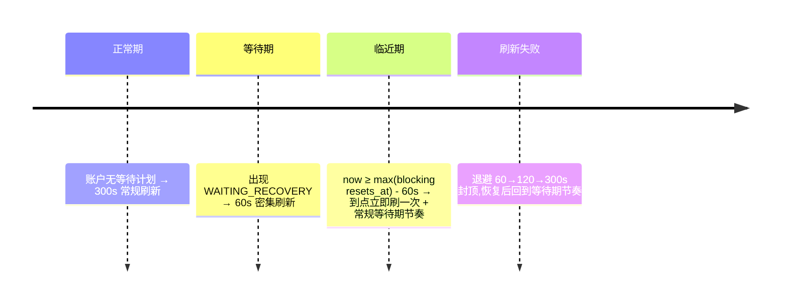

# 提前恢复机制设计(early-recovery.md)

| 项 | 值 |
| --- | --- |
| 状态 | v1.1(Phase 4 实现:E1–E4 观察侧 + check 命令落地;投递复用点待 Phase 5) |
| 覆盖需求 | FR-06 |
| 关联 | [quota-monitoring.md](quota-monitoring.md)(恢复判定)、[recovery-state-machine.md](recovery-state-machine.md)(守门) |

---

## 1. 问题与立场

`resets_at` 只是**调度参考**:官方可能提前重置,用户也可能自行兑换官方赠送的重置券。机械等待旧 `resets_at` 会浪费数小时的可用额度。本机制的目标:**在等待期内以只读探测发现"额度实际已可用",并立即走完整守门流程投递**——提前恢复不是一条捷径,只是把评估时机提前。

安全立场不变:提前恢复**复用** G1..G12 全部守门与 quota-monitoring.md §5.2 的三证据恢复判定,没有任何条件放宽(FR-06-A2)。被禁止的也依旧禁止:工具永远不会自己去兑换重置券(FR-07)。

## 2. 检测信号(全部只读)

等待 `WAITING_RECOVERY` 的会话所在账户进入密集刷新(默认 60s,可配),信号按确定性排序:

| 信号 | 判定 | 说明 |
| --- | --- | --- |
| E1 `ordinaryUsageAllowed` 变 true | 实时快照该字段 false→true | 最权威信号(schema 描述:后端权威放行) |
| E2 窗口滚动 | 同 bucket_key 窗口的 `resets_at` 变化(新窗口)或 `used_percent` 骤降(较上次快照下降 > 恢复下限差值) | 官方提前重置/窗口提前滚动 |
| E3 重置券已兑换 | `rateLimitResetCredits` 摘要中某 credit 状态 `available→redeemed/redeeming`,或可用数量减少且额度恢复 | 用户手动兑换后的自然结果;我们只观察状态字段,**绝不调用** `account/rateLimitResetCredit/consume` |
| E4 服务端推送(若可用) | App Server 通知 `account/rateLimits/updated` | 免轮询的即时信号;不可用则退回定时轮询 |

任一信号触发 → 立即对该账户执行一次强制实时刷新(非 stale)→ 对全部等待中计划跑守门 → 通过则投递(与到期恢复同一代码路径,零特例)。

## 3. 调度节奏

- 密集刷新只作用于**存在等待计划的账户**,无计划的账户维持 300s,避免无意义查询放大。
- `check` 命令(FR-06-A3)= 手动触发一次"刷新+评估+按需投递",内部与调度器同路径;`--no-deliver` 纯只读。

## 4. 提前恢复的安全不变量

| 不变量 | 来源 |
| --- | --- |
| 只读探测:提前恢复路径上没有任何变更类调用 | FR-07 白名单 |
| 投递仍需三证据恢复判定(窗口滚动证据 + 新鲜实时快照 + ordinaryUsageAllowed) | quota-monitoring.md §5.2 |
| 人工消息检测照常(G3):等待期内用户先手动续了 → SUPERSEDED,提前恢复作废 | recovery-state-machine.md |
| 重复投递防护照常(G4/UNIQUE) | queue-safety.md |
| 每账户查询频率有上限(60s 下限),防抖 | quota-monitoring.md §6 |

## 5. 通知与展示

- 触发提前恢复投递成功确认后发 `early_recovery_detected`(dedup: 每 failure 一次),内容注明检测到的信号类型(E1/E2/E3/E4)与原计划时间 vs 实际时间差。
- `status` 展示等待中计划的"参考重置时间"与"下次刷新时间",明示前者非权威。

## 6. 关键设计决策

| # | 决策 | 理由 | 被否决的替代 |
| --- | --- | --- | --- |
| D-ER-1 | 提前恢复与到期恢复共用一条代码路径 | 零特例=零额外风险面;行为可预测 | 单独快速通道(少守门,危险) |
| D-ER-2 | 观察重置券状态而非消费它 | FR-07 红线;用户兑换的效果通过额度数据自然可见 | 工具代兑换(绝对禁止) |
| D-ER-3 | 密集刷新按账户且限频 60s | 平衡及时性与克制(参考项目等待期 1s 轮询针对队列确认,额度探测我们取稳妥下限) | 1s 级额度轮询(无必要的服务端压力) |
| D-ER-4 | `resets_at` 只影响刷新节奏,不影响投递资格 | 任务书 FR-06-A4:不依赖固定时长推算恢复 | 到点即视为已恢复(禁止) |
---

## 7. Phase 4 实施记录(2026-10-27)

- **模块**:`recovery/early.py`(E1 ordinary 翻转 / E2 窗口滚动或跌破 resume_max / E3 reset credits 观察 / E4 服务端通知,全部只读);信号在调度器 `_evaluate_waiting` 内以"失败时刻基线快照 vs 当前最新快照"计算,任一信号或 not_before 到期即触发评估(与到期恢复同一代码路径,D-ER-1)。
- **E3 数据面**:`rateLimitResetCredits` 摘要(available_count + credits[].status)经 appserver 解析器提取并随 0002 迁移结构化入库;**绝不调用 consume**(T-GUARD-06 全剧本断言)。E4 通知按账户归属(`QuotaService.last_server_notifications`),method 常量集中于 codexif/appserver.py。
- **`check` 命令**:强制实时刷新(手动触发不受节奏限制)+ 全会话评估,输出逐守门结果;`--no-deliver` 零投递副作用(deliveries 恒空、无 DELIVERING、仅白名单只读方法)。Phase 4 内 check 与调度器同路径,ready=True 时审计 `delivery_ready`(不投递)。
