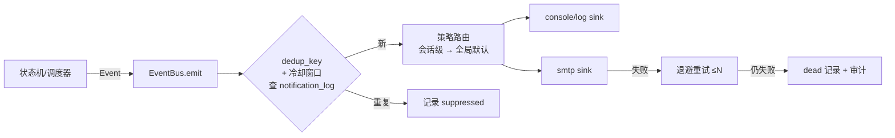

# 通知机制设计(notifications.md)

| 项 | 值 |
| --- | --- |
| 状态 | Phase 1 定稿 v1.0 |
| 覆盖需求 | FR-11、NFR-06 |
| 关联 | [persistence.md](persistence.md) §3(notification_log)、[cli-design.md](cli-design.md)(doctor 的通知自检) |

---

## 1. 架构:事件总线 + 可插拔 Sink



- `Sink` 接口:`send(event: Notification) -> None`(抛异常表示失败);新增渠道(如 Telegram/webhook)实现该接口即可,第一版只交付 console 与 SMTP。
- **通知绝不阻塞主流程**:`emit` 在独立线程池执行 SMTP 网络操作,守护进程主循环只入队;队列上限(默认 100)溢出时丢弃最旧并审计(通知是尽力而为,投递安全才是硬约束)。

## 2. 事件目录

| 事件类型 | 触发 | 默认渠道 | dedup key 构成 | 默认冷却 |
| --- | --- | --- | --- | --- |
| `quota_exhausted_five_hour` | 五小时窗口 ≥ 阈值且产生失败轮次 | console+smtp | `q5h:{account}:{window_resets_at}` | 至窗口重置(每窗口一次) |
| `quota_exhausted_weekly` | 每周窗口 ≥ 阈值 | console+smtp | `qw:{account}:{window_resets_at}` | 每窗口一次 |
| `quota_exhausted_unknown` | 额度未知但轮次疑似额度中断 | console+smtp | `qu:{session}:{turn_id}` | 每轮次一次 |
| `early_recovery_detected` | 等待期检测到提前恢复 | console+smtp | `er:{failure_id}` | 每失败一次 |
| `queue_accepted` | 投递被接受 | console+smtp | `qa:{delivery_id}` | 一次 |
| `recovery_confirmed` | 确认新轮次开始 | console+smtp | `rc:{failure_id}` | 一次 |
| `recovery_failed` | 投递被拒绝/确认超时 | console+smtp | `rf:{failure_id}` | 一次 |
| `needs_human` | 进入 NEEDS_HUMAN | console+smtp | `nh:{session}:{failure_id}` | 一次 |
| `superseded_by_human` | 失败后检测到人工消息 | console | `sh:{session}:{failure_id}` | 一次 |
| `task_completed` | 检测到任务完成(非投递后果) | console | `tc:{session}:{turn_id}` | 每轮次一次 |
| `session_missing` | rollout 文件缺失/损坏 | console+smtp | `sm:{session}:{date}` | 每日一次 |
| `quota_snapshot_source_changed` | 实时源降级/恢复 | console | `qs:{account}:{date}:{from}->{to}` | 每日每转换一次 |

说明:任务书 FR-11 列出的八类事件全部覆盖;`superseded_by_human`、`session_missing`、`quota_snapshot_source_changed` 为设计新增(需求文档 §9 已记录差异)。所有事件同时写审计表(不经过去重)。

## 3. 渠道实现

### 3.1 console/log sink

- 守护进程:结构化日志行(stdout/journald)+ 审计表;journald 天然可 `journalctl -u codex-autopilot -f`。
- CLI:直接终端输出。

### 3.2 SMTP sink(通用实现,无服务商硬编码)

配置示例(完整配置见 [examples/config.toml](../examples/config.toml)):

```toml
[notify.smtp]
enabled = false
host = "smtp.example.com"       # 任何服务商:QQ/Gmail/自建…… 只是 host 不同
port = 465
encryption = "ssl"              # ssl | starttls | none(强烈不建议 none)
username = "alerts@example.com"
password_env = "CODEX_AUTOPILOT_SMTP_PASSWORD"  # 从环境变量读,不落配置文件
from = "codex-autopilot <alerts@example.com>"
to = ["me@example.com"]
```

- 凭据只从环境变量或 `password_command`(如 `pass show …`)读取,**绝不写入配置文件/数据库**(NFR-09)。
- 邮件主题模板固定:`[codex-autopilot][{severity}] {session_name}: {event_summary}`;正文含事件元数据与建议动作,不含会话对话内容。
- 失败重试:3 次,指数退避 30s/120s/480s,仍失败转 dead 并审计(场景 S-19)。

## 4. 策略路由

`notify_policy`(会话级,JSON)覆盖全局默认:

```json
{
  "quota_exhausted_weekly": {"channels": ["console"], "cooldown": 3600},
  "needs_human": {"channels": ["console", "smtp"]}
}
```

- 会话策略只做**收紧或加渠道**;`needs_human` 与 `recovery_failed` 两类安全事件不可被会话策略完全关闭(最少保留 console + 审计)——用户必须有机会知道工具停手了。

## 5. 去重语义

- dedup key 是确定性的(见 §2 表),由事件产生方与 `notification_log` 中的既有记录比对:`UNIQUE(dedup_key, channel)` 命中且在冷却窗口内 → suppressed(仍落库 status=suppressed,便于观察)。
- 窗口类事件的 key 用 `window_resets_at`:同一窗口只通知一次,窗口滚动后新窗口是新 key——天然避免"每 tick 都发额度耗尽邮件"。
- 重启进程不重发(状态在数据库)。

## 6. 测试要点(详见 testing.md)

- 每事件类型 × 每渠道:发送成功、发送失败、去重命中、冷却过期后再发;
- S-19(SMTP 不可达)→ 重试 → dead,主流程不受影响;
- dedup key 稳定性:同输入必同 key(含时间无关性);
- 安全事件不可关闭策略的强制测试。
