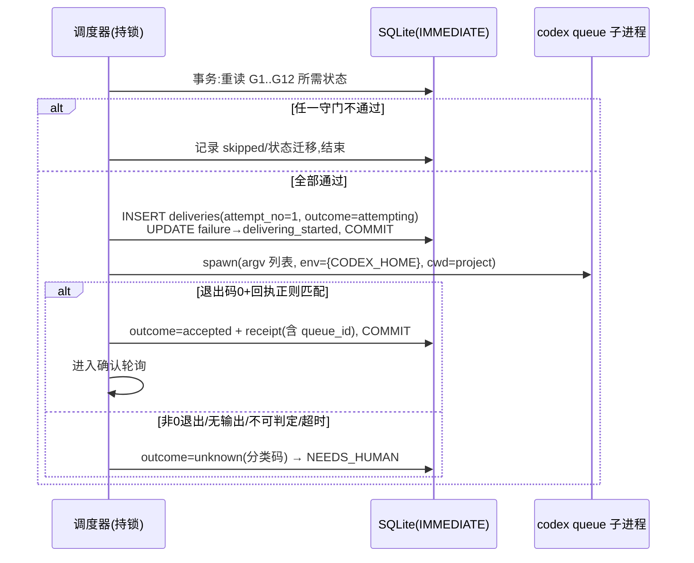

# queue 投递安全与幂等设计(queue-safety.md)

| 项 | 值 |
| --- | --- |
| 状态 | Phase 1 定稿 v1.0 |
| 覆盖需求 | FR-05、FR-07、FR-08 |
| 关联 | [recovery-state-machine.md](recovery-state-machine.md)(何时投递)、[persistence.md](persistence.md) §5/§7(落库与崩溃) |

本文档是全项目安全性的核心:**为什么可以放心让一个工具在无人值守时向你的 Codex 会话发消息**,答案必须完备到每一行。

---

## 1. 投递原语

唯一允许的变更类外部命令(设计决策 D7):

```
codex queue --thread <SESSION_UUID> --message=<CONTINUATION_MESSAGE>
```

- `--thread` 只接受**注册记录中的 canonical UUID**(本机 0.162.1 `--help` 实证:该参数同时接受"Session UUID or exact session name"——我们**只用 UUID**,禁用名称形式,消除同名歧义;见 phase0-research.md §2.1)。
- `--message` 采用**单元素等号形式** `--message=<text>`(参考项目实证):以 `-` 开头的消息正文不会被 arg parser 误认为选项;两元素形式存在此注入面。
- argv 以**列表**形式传给 `subprocess`(无 shell);`CommandRunner` 结构校验见 §9。
- 不附加任何其他 flag:不选模型、不传图片、不 `--last`、不 `--cd`——续作消息应沿用会话现有配置。
- **不附加 `-c …` 配置覆盖与 `--remote` 路由**(参考项目为关遥测加 `-c analytics.enabled=false` 等,并在受管 daemon 场景加 `--remote unix://`;见 phase0-research.md §3-I4)。取舍:纯净 argv 消除配置覆盖与 daemon 路由的兼容复杂度;代价是投递进程可能产生 Codex 遥测事件、且在"受管 app-server daemon 拒绝嵌入式 queue server"的环境下会失败——该失败会落入 `unknown` → NEEDS_HUMAN(fail-closed 可接受),L3 验收时确认是否需要引入受支持的覆盖形式(风险 R-04)。
- 环境继承最小化:`CODEX_HOME` 按目标账户设置;其余继承(需要 PATH 找到 codex)。工作目录 = 会话注册的 project_path。
- **投递语义背景(源码确认,phase0-research.md §2.1)**:`codex queue` 需能发现共享本地 app-server daemon(或显式 `--remote`);它把消息经 `thread/queue/add` 持久化到 `queue_N.sqlite` 后立即返回,**不直接启动轮次**——daemon 仅在目标线程已加载且空闲时派发。因此:目标会话的 TUI/加载状态决定消息何时真正执行,而这属于用户环境(我们不管理);消息滞留队列期间安全不丢失。0.164.0 无 `codex queue --resume`(≥0.165 才有,可让 daemon 主动 resume 线程实现无 TUI 投递)——v1 不使用,待目标版本普升后作为白名单扩展评审。

## 2. 守门检查(G1..G12)

投递前在同一 IMMEDIATE 事务内重新读取持久状态逐项验证,全部通过才执行。**任何一项无法评估(而非明确失败)同样不通过**。

| # | 守门 | 数据来源 | 不通过时 |
| --- | --- | --- | --- |
| G1 | failure 仍 open 且未被取代/取消 | failures 表 | 取消计划 |
| G2 | 会话 rollout 文件存在、尾部可解析、UUID 与注册一致 | 文件系统 | → MISSING |
| G3 | 失败轮次之后**无任何**不含我方 marker 的 user 消息(人工未介入) | rollout / thread_items(按可用性择优) | → SUPERSEDED |
| G4 | 无既有投递(成功/在途/未知)针对该 failure | deliveries 表 UNIQUE | 终止(不变量兜底) |
| G5 | 目标 UUID 来自注册记录且格式 canonical | sessions 表 | 终止 + 审计(配置损坏) |
| G6 | 全部阻塞窗口解除(规则见 quota-monitoring.md §5,需新鲜证据) | 最新快照 | 继续等待 |
| G7 | 会话无进行中轮次(尾部无未闭合 turn;app-server 可用时交叉验证 thread 状态;**不确定视为在跑**) | rollout(+app-server) | 延后 |
| G8 | `enabled`、`auto_resume` 均为真,无全局暂停 | sessions + runtime_flags | 冻结 |
| G9 | 调度器持有单实例锁且本 failure 无并发在途投递 | flock + deliveries | 终止本 tick |
| G10 | 续作消息模板渲染非空、长度 ≤ 上限(默认 2000 字符)、无控制字符 | 模板引擎 | → NEEDS_HUMAN(配置错误) |
| G11 | 数据库完整性正常(本 tick 无 fault 记录) | 启动清扫结果 | 受限模式,全部冻结 |
| G12 | 距上次对该会话的任何投递 ≥ 最小间隔(默认 10 分钟,防抖) | deliveries | 延后 |

## 3. 续作消息模板与 marker

- 全局默认与会话级覆盖;占位符白名单:`{session_name}`、`{failure_kind}`、`{failure_id}`、`{detected_at_local}`(白名单制防泄漏,参考项目实证:禁用 `{prompt}`/`{error}` 等会带出会话内容的占位符)。
- 默认模板(英文、明确):`Continue the previous task automatically. (codex-autopilot resume #{failure_id})`
- **每条投递消息尾部追加唯一 marker**(幂等与确认的锚,借鉴参考项目并改用自己的前缀):
  ```
  <渲染后模板>\n\n[codex-autopilot:<16hex>]
  ```
  16hex 由 `failure_id` 派生(确定性)。marker 用途:① 确认协议在队列库/历史库/JSONL 中唯一定位"我们的消息"(§6);② 人工消息检测排除我们自己的投递(G3);③ marker 明文可见,文档提示用户不要把带 marker 的文本复制到别处(会造成误认)。
- 长度与字符约束:渲染后 ≤8192 字符、无 NUL(参考项目同限);超限 → NEEDS_HUMAN(配置错误)。

## 4. 投递结果分类(FR-05-A3)

采纳参考项目的核心原则并实证其根据:**spawn 之后的一切不确定都是终态,绝不重发**("Only spawn failure permits retry. Every post-spawn uncertainty is terminal.")——因为非零退出/无输出都可能是"Codex 已入队但回报失败",无法从客户端侧区分。

| outcome | 判定 | 含义与处置 |
| --- | --- | --- |
| `accepted` | 退出码 0 **且** stdout 精确匹配回执正则:`Queued message ([0-9a-f-]{36}) for thread <thread-id>\.`(0.162.x/参考项目双重实证);从回执提取 **queue_id** 存入 receipt | → DELIVERED_UNCONFIRMED,进入确认轮询(§6) |
| `unknown` | 其余一切 spawn 后情形:非零退出码、stdout 空/不匹配、超时(默认 45s)被杀、进程崩溃 | → NEEDS_HUMAN(S-12/S-13;**绝不重试**)。回执诊断只记固定分类码(`exit_nonzero`/`empty_stdout`/`unrecognized_stdout`/`timeout`),**不落 stdout/stderr 原文**(可能回显消息或凭据,参考项目同款纪律) |
| `not_started` | spawn 本身失败(进程未创建:二进制缺失/权限) | 唯一可重试类:退避 30/60/120/300s,至多 5 次后 NEEDS_HUMAN |

超时杀死:`process.kill()` + 回收等待;SIGKILL 后仍无法回收 → 受限模式。

## 5. 投递协议(时序)



**崩溃矩阵**(任意时点 kill -9 守护进程):

| 崩溃点 | 数据库状态 | 重启后 |
| --- | --- | --- |
| 登记事务提交前 | 无变化 | 重新评估,守门照常(可能重走流程,无害) |
| 登记后、spawn 前 | `attempting` | 清扫→`unknown`→NEEDS_HUMAN |
| 子进程运行中 | `attempting` | 同上(queue 可能已收到消息——宁可信其已收到) |
| 子进程结束、结果落库前 | `attempting` | 同上 |
| 结果落库后 | `accepted`/`rejected`/`unknown` | 按 outcome 继续(确认轮询或 NEEDS_HUMAN) |

结论:不存在"崩溃导致重复投递"的窗口——第二次投递必然撞上 G4/UNIQUE。这是整个设计的基石(设计决策 D8)。

## 6. 确认协议

确认证据分三级,按数据源可用性自动选择(能力探测见 phase0-research.md §2.4;任何一级都不确定时按更低证据处理,全部不确定 → 超时 NEEDS_HUMAN):

| 级 | 证据 | 数据源 | 结论 |
| --- | --- | --- | --- |
| C1 队列在途 | `queue_N.sqlite.queued_items`(`~/.codex/` 根,0.162/0.164 均实证)中存在含 marker 的行 | queue SQLite(只读) | queue 已接受、消息已持久化、等待线程加载且空闲(Codex daemon 内建语义,源码确认)。**C1 正证据期间不触发确认超时**(recovery §6) |
| C2 轮次开始 | 历史库 `thread_items` 出现含 marker 的 `userMessage` 行,或 JSONL 出现含 marker 的 user `response_item`;`task_started.turn_attribution.turn_trigger == "queue"` 为强佐证(源码确认该值专属于队列派发,人工输入为 `"user"`) | `thread_history_*.sqlite` / rollout JSONL | → RECOVERED(新轮次由我们的消息发起) |
| C3 轮次结局 | 该轮 `status` 与进展(完成后观察 10s 落库):completed+进展=真恢复;failed+进展=恢复后再撞限额(链入新 failure 而非本轮失败);`turn_trigger=="user"` 或不含 marker 的 user 消息=人工接管 | thread_history / JSONL `task_complete` | 更新 failure 终态 + 通知 |

确认轮询与守门共享增量解析器(同一游标),确认事件写 confirmations 表(method=C1/C2/C3 证据类型)。投递被接受后:若 C1 无正证据(队列中无我方行)且默认 30 分钟(可配)内无 C2 证据 → NEEDS_HUMAN(消息可能未被持久化——绝不重投);C1 有正证据则无限期等待并低频提醒(会话未被加载是预期情形)。

## 7. 接口白名单:App Server 客户端(NFR-01/FR-07-A1)

客户端唯一职责是只读查询。方法白名单(硬编码于 `AppServerClient` 源码,调用层直接调用具名方法而非字符串):

| 方法 | 用途 |
| --- | --- |
| `initialize` | 握手(协议要求) |
| `account/rateLimits/read` | 实时额度 |

未来若需 thread 只读方法(`thread/read`、`thread/turns/list`、`thread/list`、`thread/loaded/list`),须走设计评审 + 新增测试,且仍限于只读。客户端类中**不存在**发起任意 method 字符串的通用 `call()` 逃生门(测试断言:源码中 app-server 请求构造只出现在具名方法内)。

**关于 `thread/queue/delete`(撤回我方队列消息)**:参考项目用它撤回已排队未投递的我方消息(防人工介入后仍被投出),并实证"删除成功≠未执行"(Codex 可能在回报删除前已开轮,需 settle 观察)。这是对 Codex 状态的**写操作**,v1 白名单不纳入;作为 Phase 5+ 的可选增强记录(配置 `allow_withdraw_own_queue_items`,默认关,启用需完整移植 settle 语义),见 development-plan.md。

## 8. 接口黑名单(FR-07-A2,出现即测试失败)

以本机 0.162.1 官方 schema 导出为权威(105 个方法,phase0-research.md §2.2),明确禁止引用:

- **额度/付费类**:`account/rateLimitResetCredit/consume`(兑换重置券——本工具的绝对红线)、`account/sendAddCreditsNudgeEmail`
- **账户类**:`account/login/*`、`account/logout`、`account/gatewayOAuth/*`
- **交易类**:`marketplace/*`、`plugin/share/checkout`、`plugin/share/*`
- **写操作类**:`config/batchWrite`、`config/value/write`、`fs/writeFile`、`fs/remove`、`fs/copy`、`thread/start`、`thread/delete`、`thread/archive`、`turn/start`、`turn/steer`、`turn/interrupt`、`thread/inject_items`、`command/exec*`、`experimentalFeature/enablement/set`、`hooks/*`、`skills/config/write` 等
- 原则:**默认全禁,白名单显式放行**;黑名单测试同时做"正向断言"(源码/配置中不出现这些字符串)与"负向断言"(白名单之外无任何方法调用路径)。

## 9. 外部进程执行层(CommandRunner)

- 只执行两类子进程:
  1. 只读探测:`codex --version`、`codex queue --help`、`codex app-server --help`(doctor 用);
  2. 变更动作:`codex queue --thread <uuid> --message <msg>`(投递,唯一)。
- `CommandRunner` 构造时校验 argv:`argv[0]` 为配置的 codex 二进制;`argv[1]` ∈ {`queue`} ∪ 探测集;`queue` 的后续参数严格匹配四元素结构 `--thread <canonical-uuid>` `--message=<非空且无 NUL>`。任何其他形态直接抛 `UnsafeCommandError`(不可能被配置绕过,FR-07-A5)。
- App Server 进程(`codex app-server`)仅由 `AppServerClient` 启动并与白名单绑定,不经过通用 CommandRunner。

## 10. 测试锁定(testing.md T-GUARD-*)

1. T-GUARD-01:CommandRunner 拒绝任意构造的 argv(模糊测试:随机 flag/子命令/管道字符)。
2. T-GUARD-02:源码静态断言黑名单方法字符串零出现;白名单外无请求构造。
3. T-GUARD-03:配置注入测试——所有配置字段(含恶意值)经全链路后不可能改变可执行命令集。
4. T-GUARD-04:硬编码扫描(真实 UUID、用户路径、`/home/`、QQ 邮箱域名、版本号字面量)。
5. T-GUARD-05:隐私扫描——源码不存在读取 `auth.json` 的路径。

## 11. 关键设计决策

| # | 决策 | 理由 | 被否决的替代 |
| --- | --- | --- | --- |
| D-QS-1 | 先落库 attempting 再 spawn | 崩溃矩阵完备(§5) | spawn 后记录(存在双投窗口) |
| D-QS-2 | spawn 后一切不确定(非零退出/无输出/超时)皆为终态 unknown,零自动重试;仅 spawn 失败可退避重试 | 非零退出也可能是"已入队"(参考项目实证);queue 无幂等键,重复消息污染会话的代价 >> 人工确认成本 | 有限重试(任何重试策略都无法排除"前次实际已送达") |
| D-QS-3 | 只用 UUID 形式的 --thread | 名称有歧义空间;UUID 精确 | 允许 name(方便但错投风险) |
| D-QS-4 | 白名单模式(默认全禁) | 新方法自动落入禁 区,评审才能放行 | 黑名单模式(新方法默认可用,危险) |
| D-QS-5 | argv 列表 + 三元素结构校验 | 双保险:OS 层无 shell,应用层校验形态 | 仅其一 |
| D-QS-6 | 消息尾唯一 marker(确定性派生)作为确认与幂等锚 | marker 是"该消息=我们投的"唯一直接证据;比时间窗/前缀匹配更强(参考项目同款机制) | 仅时间窗推断(可误认人工消息) |
