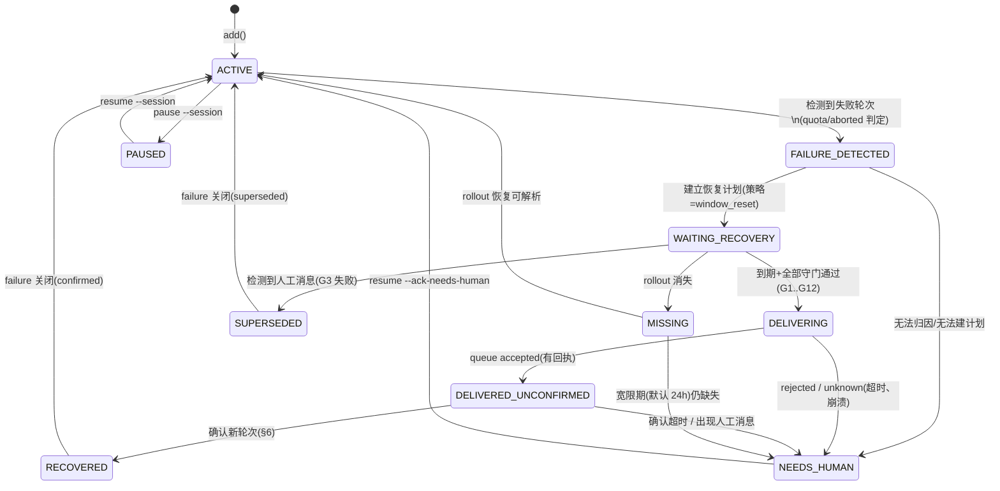

# 恢复状态机设计(recovery-state-machine.md)

| 项 | 值 |
| --- | --- |
| 状态 | Phase 1 定稿 v1.0 |
| 覆盖需求 | FR-05、FR-06、FR-08(状态部分) |
| 关联 | [queue-safety.md](queue-safety.md)(守门与投递协议)、[quota-monitoring.md](quota-monitoring.md)(恢复判定) |

---

## 1. 设计原则

1. **状态机是唯一真相源**:任何组件对会话"现在该做什么"的判断只能来自持久化的状态 + 迁移规则;崩溃重启后从数据库状态继续,不依赖内存。
2. **fail-closed**:每条迁移的守卫条件必须全部**可证实**;任何"无法证实"都迁移到 NEEDS_HUMAN,而非留在原状态空转或乐观前进。
3. **迁移可审计**:每次迁移写入 `state_history`(from/to/reason/evidence),reason 为稳定机器码(不做文案)。
4. **失败轮次(failure)与会话状态分离**:failure 是一次事件的记录(不可变事实),会话状态是当前处置;一个会话顺序上可有多个 failure,同一时刻至多一个活动。

## 2. 状态集

| 状态 | 含义 | 允许的下一状态 |
| --- | --- | --- |
| `ACTIVE` | 监控开启,无待处理失败(任务可能在跑也可能空闲) | `FAILURE_DETECTED`、`MISSING`、`PAUSED` |
| `FAILURE_DETECTED` | 瞬态:本轮 tick 刚确认一个失败轮次并落库 | `WAITING_RECOVERY`、`NEEDS_HUMAN`(无法制定计划) |
| `WAITING_RECOVERY` | 已有 armed 恢复计划,等待额度条件(含提前恢复监听) | `DELIVERING`、`SUPERSEDED`、`NEEDS_HUMAN`、`MISSING`、`PAUSED` |
| `DELIVERING` | 瞬态:`codex queue` 子进程在途(全局至多一个) | `DELIVERED_UNCONFIRMED`、`NEEDS_HUMAN`(rejected/unknown) |
| `DELIVERED_UNCONFIRMED` | queue 已接受,等待确认新轮次 | `RECOVERED`(确认)、`NEEDS_HUMAN`(确认超时/出现人工消息) |
| `RECOVERED` | 终态(对本 failure):续作确认成功;会话随即回 ACTIVE | `ACTIVE` |
| `SUPERSEDED` | 终态(对本 failure):人工已介入(用户消息/手动续作) | `ACTIVE` |
| `NEEDS_HUMAN` | 终态(对本 failure):fail-closed 停手,等待 `resume --ack-needs-human` | `ACTIVE`(仅经人工确认) |
| `MISSING` | rollout 文件缺失/不可解析(可自动恢复观察) | `ACTIVE`(文件回来)、`NEEDS_HUMAN`(超过宽限期) |
| `PAUSED` | 用户暂停(`enabled=0` 覆盖层,见 §5) | `ACTIVE` |

## 3. 状态图

注:PAUSED/MISSING 与其他状态的关系是**覆盖层**(overlay)而非互斥迁移——被暂停的会话冻结一切自动迁移(审计仍记录暂停期间观察到的失败,但不建计划不投递);MISSING 期间投递守门恒失败(G2)。实现上 `session_state.state` 存主状态,`enabled` 与文件存在性作为覆盖条件参与守门,避免状态爆炸。

## 4. 失败检测(进入 FAILURE_DETECTED 的条件)

### 4.1 数据源(自适应,按可用性择优)

| 源 | 可用性 | 用途 |
| --- | --- | --- |
| `thread_history_*.sqlite`(Codex 自带,只读 URI 打开) | 0.162.1 CLI 与 0.164 均实证存在(位于 Codex Home 根,代数后缀 `_N`,动态发现) | 主源:结构化轮次状态/错误归因/消息清单 |
| `queue_*.sqlite`(Codex 自带,只读) | 同上 | 队列在途观察(C1 确认证据) |
| rollout JSONL(`sessions/**/rollout-*.jsonl`,含分裂链 `<A>_<B>.jsonl` 与 `archived_sessions/`) | 所有版本恒有 | 回退源与证据补充;额度快照(`token_count.rate_limits`)的来源 |

读取纪律(参考项目同款):SQLite 一律 `mode=ro` + `PRAGMA query_only=ON` + `trusted_schema=OFF`;JSONL 只解析完整行,尾部撕裂行忽略(FR-08-A8/S-23);发现路径按代数后缀(`_N`)动态解析,缺必需列即拒用该源。

### 4.2 判定规则

**主源路径**(thread_history 可用时):每会话最新轮次(`rollout_ordinal` 最大)且 `status='failed'`,按 `error_json` 中 `codexErrorInfo` 变体归类(参考项目实证的变体表摘录,完整表见 phase0-research.md §3):

| codexErrorInfo | 我们的处理 | failure.kind |
| --- | --- | --- |
| `usageLimitExceeded` | 进入额度失败流程 | 按阻塞窗口细分(§4.3) |
| `rateLimitExceeded` / `responseTooManyFailedAttempts`+429 | 瞬时限流,v1 记录+通知,不自动续(未来扩展) | `rate_limit_transient` |
| `serverOverloaded`/`internalServerError`/`httpConnectionFailed`/`responseStream*` | 同上(瞬态类) | `transient` |
| `contextWindowExceeded`/`badRequest`/`policy`/`unauthorized` 等 | 终态类:NEEDS_HUMAN(重试无意义) | `terminal_*` |
| 未知变体 | **unknown 永不自动重试**(参考项目铁律,采纳) | `unknown` → NEEDS_HUMAN |

`status='interrupted'`(用户中断)→ 直接 NEEDS_HUMAN(FR-08-A6:用户取消绝不自动重启)。

**回退路径**(仅 JSONL):轮次未闭合(有 `turn_context`/`task_started` 而无对应 `task_complete`)或 `task_complete` 事件含 `error.codex_error_info == "usage_limit_exceeded"`(注意与库内 camelCase 变体拼写不同,两处都要兼容)+ 同期 `token_count` 快照显示窗口 ≥ 阈值。

### 4.3 额度失败的 kind 细分

取失败时刻最近的额度快照(JSONL `token_count.rate_limits`,按 `limit_id` 分桶):

- 任一桶 primary(五小时)≥ 阈值 → 记入 blocking;secondary(每周)≥ 阈值 → 记入 blocking;两者 → `quota_multi`;
- `spend_control_reached` 或 `rate_limit_reached_type` ∈ credits/workspace 类 → `quota_credits`/`quota_spend_control`(blocking 无 resets_at,只能人工/官方解除);
- 无快照可证且无法排除额度原因 → `quota_unknown`(策略 manual_ack,不自动投递);
- **90–98% 的窗口只作 reset 提示**(hint,参考项目实证:真实样本 primary=98% 即失败,服务器侧预扣),hint 到点必须现场实时复查才算恢复——不影响"≥99% 才判失败"的默认阈值。

### 4.4 通用规则

- **归因需要证据**:kind 由结构化证据决定;`quota_unknown` 只有在"轮次确未完成 + 无法排除额度原因"时成立,策略 `manual_ack`(不自动投递)——不能证实归因,就不能证实恢复条件。
- 同一 turn 只记一个 failure(UNIQUE 约束);重复观察幂等(已 open 的不重开);failure 内容含 interruption 身份哈希(thread+turn+completed_at),天然去重(参考项目同款)。
- 判定只基于完整行/可读库;任何解析失败该会话本轮跳过并审计。
- 任务完成(`task_complete`/`status='completed'`)→ 不算失败;发 `task_completed` 通知(S-26)。

## 5. 覆盖层:暂停与全局暂停

- 会话 `enabled=false` → 一切自动迁移冻结(含失败检测建计划);但 tick 仍探测文件存在性(供 status 展示),审计记录"暂停期间观察到失败"。
- 全局暂停(`runtime_flags.global_pause`)→ 投递动作冻结,其余照常(额度采集、审计)。
- S-24 验收:暂停期间额度恢复不投递;解除暂停后下一次评估正常进行(不因"错过窗口"而补投——守门通过才投,与时刻无关)。

## 6. DELIVERED_UNCONFIRMED 的确认子协议

投递被接受后(见 queue-safety.md §4/§6),确认轮询(每 tick)按三级证据(C1 队列在途 → C2 轮次开始 → C3 轮次结局,定义在 queue-safety.md §6):

1. **C2 命中**(队列库/历史库/JSONL 出现含我方 marker 的用户消息并开轮;`task_started.turn_attribution.turn_trigger == "queue"` 为强佐证,源码确认该值专属于队列派发)→ RECOVERED;
2. C3 随后细化结局:completed+进展=确认关闭;failed+进展=恢复后再撞限额(链入**新** failure,本轮仍算恢复成功);出现 `turn_trigger=="user"` 或不含 marker 的 user 消息=人工接管(SUPERSEDED + 通知);
3. **C1 正证据语义**(源码确认:Codex 把排队消息持久化在 `queue_*.sqlite`,仅当线程已加载且空闲时才投递):C1 显示我方消息仍在队列 → 保持等待,**不触发确认超时**(消息不会丢失,只是会话未加载);每 6 小时发一次提醒通知("已排队,等待会话被加载/空闲",dedup 限频);若用户长期不开会话,这是预期行为而非故障;
4. **确认超时**(默认 30 分钟,可配)仅在"C1 无正证据(队列中无我方行)**且**无 C2"时触发 → NEEDS_HUMAN(可能 queue 接受了但消息未入队——语义差异,绝不重投)。

## 7. 迁移守卫与证据(reason 码表)

| 迁移 | reason 码 | 必要证据(evidence JSON) |
| --- | --- | --- |
| →FAILURE_DETECTED | `failure_detected` | turn_id、判定事件摘要、当时快照 id |
| →WAITING_RECOVERY | `plan_armed` | plan_id、各阻塞窗口 resets_at |
| →DELIVERING | `guards_passed` | G1..G12 各项结果快照 |
| →DELIVERED_UNCONFIRMED | `queue_accepted` | delivery_id、回执摘要 |
| →NEEDS_HUMAN | `queue_rejected`/`queue_unknown`/`confirm_timeout`/`abort_no_quota`/`unknown_quota_kind`/`missing_over_grace`/`db_inconsistent` | 对应失败细节 |
| →SUPERSEDED | `human_message_seen` | 非模板 user 消息摘要(时间戳+首 N 字符,不含全文) |
| →RECOVERED | `new_turn_confirmed` | 确认方法与匹配事件摘要 |
| →ACTIVE(自 NEEDS_HUMAN) | `manual_ack` | 操作者、时间、被确认的 failure_id |

## 8. 并发与重启

- 状态迁移全部在 IMMEDIATE 事务内完成(读取守门状态 + 写迁移原子化),单线程调度器 + 单实例锁(persistence.md §2)下无竞态。
- 崩溃重启:启动清扫(persistence.md §7)后,`DELIVERING` 残留 → 对应投递 attempting→unknown → NEEDS_HUMAN;`FAILURE_DETECTED` 残留(瞬态崩溃)→ 下一 tick 重新评估(失败记录已落库,幂等)。

## 9. 关键设计决策

| # | 决策 | 理由 | 被否决的替代 |
| --- | --- | --- | --- |
| D-SM-1 | 瞬态状态(DETECTING/DELIVERING)也持久化 | 崩溃后能识别"曾有动作在途" | 只持久稳定态(丢失在途信息,重复投递风险) |
| D-SM-2 | PAUSED/MISSING 为覆盖层而非独立迁移目标 | 状态空间组合爆炸;守门统一处理 | 全部展开为互斥状态(状态数 ×3) |
| D-SM-3 | `quota_unknown` 不自动恢复 | 不能证实归因 ⇒ 不能证实恢复(推断链断裂) | 乐观尝试(违背 fail-closed) |
| D-SM-4 | 确认以消息尾 marker 为最强证据(C2) | marker 是唯一能把"新轮次=我们的消息"直接钉死的证据;时间窗推断会把用户手动消息误认为我们的 | 仅 new_turn 时间窗推断(误认人工消息) |
| D-SM-5 | 用户取消(aborted)永不自动重启 | 任务书红线 FR-08-A6 | 视作可恢复失败(违背用户意图) |
| D-SM-6 | RECOVERED 后回 ACTIVE 而非终态监控 | 同一会话可能再次额度耗尽,循环服务 | 单次恢复后停止监控(与长期无人值守目标矛盾) |
