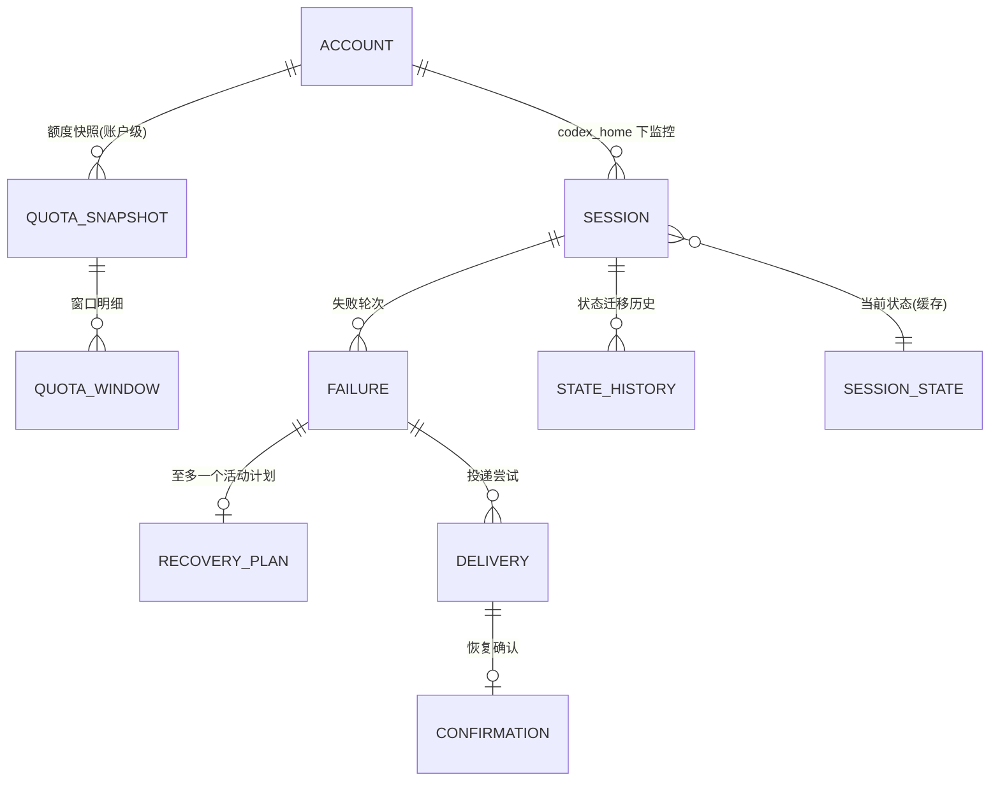

# 会话管理设计(session-management.md)

| 项 | 值 |
| --- | --- |
| 状态 | Phase 1 定稿 v1.0 |
| 覆盖需求 | FR-01、FR-02、FR-08(部分)、NFR-03 |
| 关联 | [persistence.md](persistence.md)(表结构)、[recovery-state-machine.md](recovery-state-machine.md)(状态字段) |

---

## 1. 核心概念:账户(Account)与会话(Session)两级模型

### 1.1 为什么需要"账户"实体

额度是**账户级共享资源**:同一 `CODEX_HOME` 下的所有 Codex 会话消耗同一个五小时窗口与每周窗口。若把额度挂在会话上,会导致:

- 每个会话重复查询同一账户额度(浪费且可能触发限流);
- 不同会话看到"不同"的额度状态(实际是同一状态的多次采样);
- 数据库无法表达"同账户多会话"的约束。

因此数据模型为两级:**Account(Codex Home)→ Session(会话)**,额度快照、额度窗口、App Server 连接全部挂在 Account 上;失败轮次、恢复计划、投递记录挂在 Session 上。



### 1.2 账户的定义与标识

- 账户 = 一个 Codex Home 目录(默认 `~/.codex`,`CODEX_HOME` 语义)。
- 账户记录字段:`id`(内部主键)、`codex_home`(规范化绝对路径,UNIQUE)、`label`(可选人类可读标签)、`created_at`。
- 路径规范化:注册时 `realpath` 解析符号链接后存储,避免同一目录多种写法产生重复账户。
- **判定依据仅为 Codex Home 路径**:两个不同登录身份共用一个 Codex Home 属于用户环境问题,本工具不尝试区分(该情形在 doctor 中提示)。

### 1.3 会话的注册信息(FR-01)

| 字段 | 类型 | 必填 | 说明 |
| --- | --- | --- | --- |
| `uuid` | TEXT | ✅ | 会话 UUID,主键,canonical 格式校验 |
| `name` | TEXT | ✅ | 全局唯一的人类可读名,CLI 操作的主键 |
| `project_path` | TEXT | ✅ | 项目路径(注册时校验存在性与可读性,可配为仅警告) |
| `account_id` | FK | ✅ | 归属账户(由 `--codex-home` 推导或创建) |
| `enabled` | BOOL | ✅ | 监控开关(默认 true) |
| `auto_resume` | BOOL | ✅ | 自动恢复开关(默认 false,**安全默认**) |
| `tmux_session` | TEXT | ⬜ | 可选 tmux 会话名(仅运维展示,见 §5) |
| `resume_template` | TEXT | ⬜ | 续作消息模板,缺省用全局模板 |
| `notify_policy` | JSON | ⬜ | 事件→渠道映射,缺省用全局策略 |
| `check_interval` | INT | ⬜ | 秒,缺省用全局间隔 |
| `created_at/updated_at` | INT | ✅ | Unix 时间(UTC) |

**默认关闭自动恢复**的理由:新用户装好工具后最坏情况是"只监控不动作",而不是"注册即自动发消息"。开启 `auto_resume` 是显式的、知情的决定。

### 1.4 会话生命周期分类(FR-02 / 任务书"会话生命周期")

| 类别 | 判定 | 工具行为 |
| --- | --- | --- |
| A. 用户手动启动并保持运行的 TUI | rollout 文件存在且活跃更新;tmux 标识为空 | 正常监控;投递用 `codex queue --thread`(源码确认:消息入 `queue_N.sqlite`,线程已加载且空闲时由 daemon 派发) |
| B. tmux 托管的 TUI | 同 A,且配置了 tmux 标识 | 同 A;doctor 额外检查 tmux 会话存活并展示 |
| C. 已退出 / 未加载 / 不存在的会话 | ① rollout 文件缺失/损坏/UUID 查无 → MISSING;② 文件在但线程未被任何 TUI/daemon 加载(队列消息会安全滞留)→ 正常监控 + status 标注"未加载" | ① MISSING:绝不创建新进程,提醒人工;② 不影响投递安全性(消息滞留队列不丢失),status/通知提示"排队等待会话加载" |
| D. 非交互 exec 模式 | (第一版)不识别 | 预留:注册模型不含此属性,未来加 `session_kind` 字段 |

关键立场:**tmux 会话存在与否不改变任何投递决策**(设计决策 D14)。`codex queue` 的语义(见 phase0-research.md §2.1)决定投递是否需要 TUI 存活——若 queue 依赖 app-server daemon 而非 TUI 进程,则 tmux 纯粹是给人看的;若需要 TUI 存活,doctor 给出提示但仍不自动拉起。两种情况下工具都不 spawn 进程。

## 2. 注册与校验规则(FR-01)

### 2.1 `add` 流程

1. 解析参数 → UUID 格式校验(canonical `8-4-4-4-12`,小写规范化);
2. Codex Home 解析:显式 `--codex-home` 或默认;检查目录存在;`realpath` 规范化;查找/创建 Account 记录;
3. 项目路径校验:存在且可读(默认拒绝,`--allow-missing-project` 降级为警告);
4. **可选但推荐**:`--discover` 在 Codex Home 的 `sessions/` 下查找该 UUID 的 rollout 文件,找到则预填 `origin`(起始时间/cwd 来自 `session_meta`),找不到给出警告(允许注册——会话文件可能在别的机器/尚未同步,但状态机会走 MISSING);
5. 唯一性检查:UUID、名称分别唯一;
6. 写入(事务),输出注册摘要(含 `auto_resume` 当前值提醒)。

### 2.2 唯一性约束(数据库层)

```sql
UNIQUE(uuid)            -- 同一 UUID 全局只能注册一次(FR-02-A4)
UNIQUE(name)            -- 名称全局唯一(CLI 主键)
```

同一 UUID 出现在两个 Codex Home 的极端情况:UUID 是全局唯一的(rollout 文件名内嵌 UUID),仍按全局唯一处理——注册第二个时给出指向第一条记录的错误。

### 2.3 名称规则

`^[a-z][a-z0-9-]{0,63}$`(小写字母开头,含数字与连字符,≤64 字符)。严格且对脚本友好;显示名可通过 `--description` 另加。

## 3. 多会话并发与隔离(FR-02)

- **进程模型**:单守护进程顺序处理所有会话(单 tick 循环,见 architecture.md §4)。不引入会话级线程:投递子进程是唯一的阻塞点,且"同一时刻至多一个投递在途"本身就是安全属性。
- **异常隔离**:tick 内对每个会话的处理包在独立 try/except 中;异常记录审计(fault 记录)并跳过该会话本轮,绝不中断整个 tick。
- **额度共享**:每 tick 按账户合并查询一次额度(FR-02-A7),结果快照写入后供该账户全部会话的评估读取;账户查询失败时该账户所有会话本轮评估降级为"额度未知"(S-20 路径),不影响其他账户。
- **状态独立**:状态机实例按会话隔离;任一会话进入 NEEDS_HUMAN 不影响其他会话的正常恢复。

## 4. 监控开关与暂停语义

三层开关,全部满足才可能投递(优先级从全局到局部):

1. **全局暂停**(`pause` 不带参数 / `--global`):调度器照常采集额度与审计,但对所有会话冻结"投递"动作;用于假期/维护窗口。持久化在 `runtime_flags` 表。
2. **会话 `enabled`**:暂停该会话全部状态机推进(检测也停止,只保留文件存在性探测);`pause --session`/`resume --session` 操作的就是它。
3. **会话 `auto_resume`**:允许检测失败与制定计划,但永不投递(纯观察模式,也是迁移期的推荐配置,见 migration-from-legacy.md)。

NEEDS_HUMAN 的解除:`resume --session <name> --ack-needs-human`,显式确认后状态机回到 ACTIVE。设计理由:needs_human 表示"工具已放弃自动处理",静默恢复可能掩盖用户未读的通知。

## 5. tmux 集成边界(设计决策 D14)

**允许**:注册时记录 tmux 会话名;`status`/`doctor` 展示 `tmux has-session` 探测结果;通知中附带 tmux 提示(如"请在 tmux 会话 X 中查看")。

**禁止**:
- 依据 tmux 存活与否决定投递(投递安全性由 queue 语义与守门决定,与 tmux 无关);
- `tmux new-session`/`send-keys` 等任何创建/操作行为;
- 将"tmux 会话存在"等同于"Codex 任务正在执行"(任务执行状态只能来自 rollout JSONL / app-server 事件)。

## 6. 会话发现辅助(非注册必需)

提供 `codex-autopilot list --codex-sessions`(只读扫描 Codex Home `sessions/`(含子目录与分裂链命名 `<A>_<B>.jsonl`)与 `archived_sessions/`,新版可交叉利用 `sqlite/codex.db` 的 `local_thread_catalog` 表;汇总最近 N 个会话:UUID、起始时间、cwd、行数、最后事件时间)帮助用户找到想注册的 UUID。同样只读。

## 7. 删除与数据保留

- `remove <name>`:软删除(`deleted_at` 置位);历史(失败/投递/审计)保留,`list`/调度不再包含。
- `remove <name> --purge`:物理删除该会话的失败/投递/确认/状态记录(审计表保留摘要),需 `--yes` 确认。账户记录无会话引用时提示可清理。
- 快照与审计的保留策略(自动清理)见 persistence.md §8。

## 8. 关键设计决策

| # | 决策 | 理由 | 被否决的替代 |
| --- | --- | --- | --- |
| D-SES-1 | 两级模型 Account→Session,额度挂账户 | 额度是账户级共享资源(任务书 FR-02 特别要求) | 额度挂会话(重复查询、状态矛盾) |
| D-SES-2 | 注册信息存 SQLite 而非 TOML | 与失败/投递记录同库,外键保证一致性;避免双源 | TOML 注册表(无事务、易与投递状态失同步) |
| D-SES-3 | `auto_resume` 默认 false | 新装工具零风险;观察模式先行 | 默认 true(违背最小惊讶) |
| D-SES-4 | tmux 仅信息展示 | 任务书明确不得假定 tmux=执行;spawn 进程是红线 | tmux 存活作为投递条件(语义错误且诱导 spawn) |
| D-SES-5 | UUID 全局唯一(跨账户) | rollout UUID 全局唯一;防两账户重复注册同一会话 | (account, uuid) 联合唯一(允许重复注册,违背 FR-02-A4) |
| D-SES-6 | 单线程顺序 tick + 会话级异常隔离 | 免锁、确定性、天然"至多一个投递在途" | 每会话线程/asyncio(竞态与测试复杂度,收益为零) |
